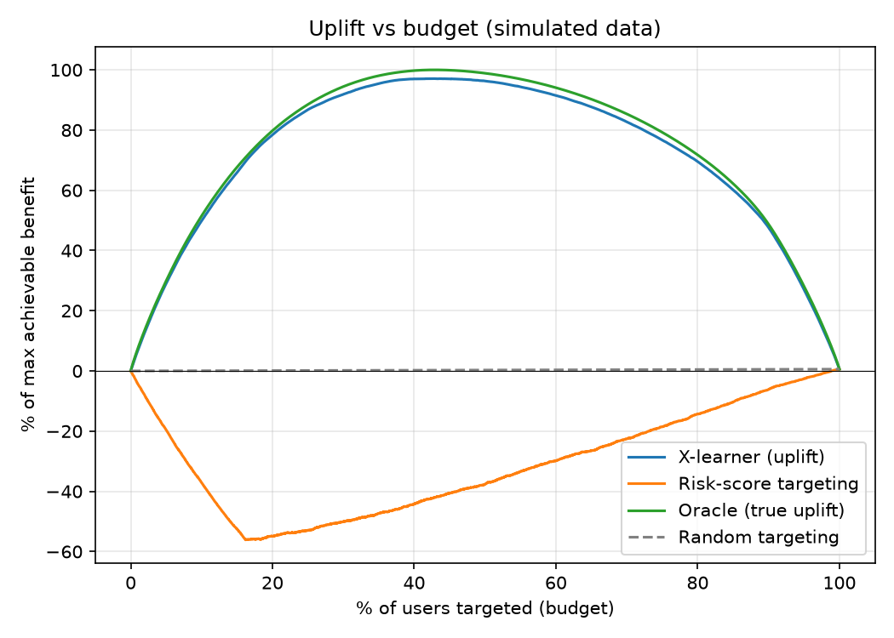
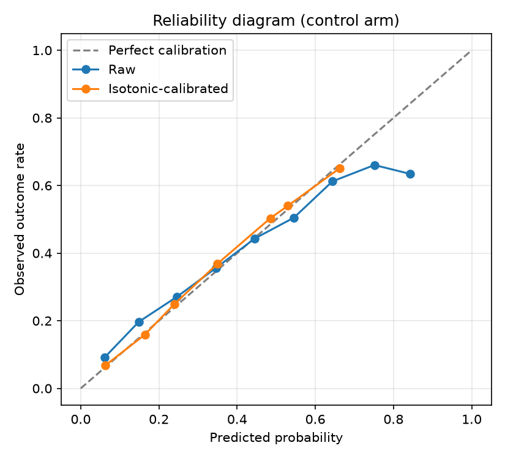

# UpliftIQ v2: Calibrated Causal Decision Platform

A small, end-to-end system that decides **who should receive an intervention**
(a reminder, an offer, a risk warning) by estimating the *causal effect* of the
intervention per user, with calibrated probabilities and uncertainty sets,
served through a REST API.

> **Everything here runs on simulated data.** The simulator has known true
> treatment effects, so models can be verified against ground truth.
> No real user data and no live deployment results are claimed.

## Why uplift and not risk prediction

A risk score tells you who is likely to have an outcome, not whom the
intervention will change. In the simulator, high-risk users are "sleeping dogs":
the intervention backfires for them.



| Targeting top 20% of users by | Share of max achievable benefit |
|---|---|
| X-learner uplift | **78.4%** |
| Risk score | **-54.9%** (net harm) |

## What is in the system

| Part | What it does |
|---|---|
| `src/simulator.py` | Generates 50,000 users with known true uplift, randomized treatment |
| `src/train.py` | X-learner and DR-learner (EconML + LightGBM) vs a risk-score baseline |
| `src/calibrate.py` | Per-arm isotonic calibration, ECE before and after |
| `src/conformal.py` | Split-conformal outcome sets with 90% target coverage |
| `src/train_final.py` | Trains the final pipeline and saves a versioned artifact in `models/<version>/` |
| `app/main.py` | FastAPI service: `/score`, `/optimize`, `/models`, `/health` |
| `tests/` | Unit, API, and property-based (Hypothesis) tests |
| `.github/workflows/ci.yml` | Lint, train and test on every push |

## Results (simulated data, held-out test set)

- **Ranking:** X-learner rank-correlation with true uplift 0.967, DR-learner 0.941,
  risk-score baseline -0.407.
- **Calibration (control arm):** ECE 0.0325 to 0.0110 after isotonic calibration.
  Calibration improves probability quality; it does not change the ranking.
- **Conformal coverage (target 90%):** 0.913 (treated arm), 0.961 (control arm).
  Control-arm coverage is conservative, likely because isotonic output is
  step-shaped and creates tied scores.



## API

All endpoints except `/health` need the header `X-API-Key`.

- `POST /score` returns uplift, calibrated probabilities for both arms,
  conformal outcome sets, and a `confident` flag.
- `POST /optimize` takes a budget and a cost per user, and returns the target list
  with expected benefit. Users with non-positive uplift are never targeted.
- `GET /models` lists model versions and metrics.

Run locally:

```bash
pip install -r requirements.txt
python -m src.simulator
python -m src.train_final v1
uvicorn app.main:app --reload
```

Docs open at `http://127.0.0.1:8000/docs`.

## Engineering notes

- **Versioning and rollback:** each training run writes `models/<version>/`.
  Set `MODEL_VERSION` to serve another version.
- **Validation and auth:** Pydantic input bounds, API key from the
  `UPLIFTIQ_API_KEY` environment variable.
- **Property-based tests:** probabilities stay in [0, 1], the budget is never
  exceeded, and negative-uplift users are never targeted. A Hypothesis test caught
  a real bug: `budget_used` was rounded up and could exceed the budget.
- **Test coverage:** 46% overall. The API and simulator are well covered; the
  training scripts run end to end in CI but are not unit-tested.

## Simplifications and known limitations

- DuckDB, Postgres, Redis, Celery, drift monitoring, and AWS deployment are not
  implemented. The cache is an in-memory dict (single process, no expiry).
- Conformal sets are for the binary outcome, not for the individual treatment
  effect, which is never observed.
- `uplift` (X-learner) and `p_treated - p_control` (two calibrated models) can
  differ; ranking uses the X-learner, probabilities come from the calibrated models.
- Latency and throughput have not been measured yet.
- Results are from a simulator and may not transfer to real data.